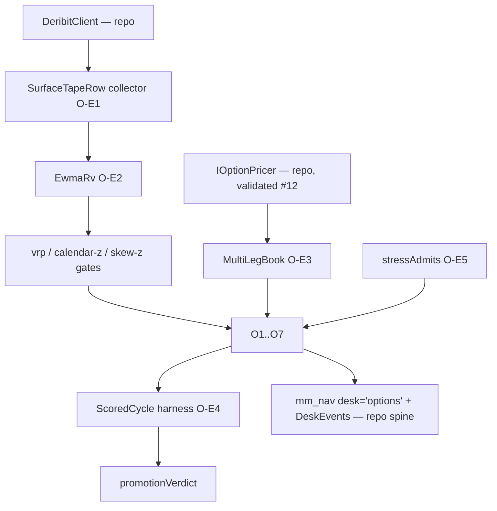

# Appendix A · Code-shape catalogue

Every interface and pure function from the chapters, in one place, organized by layer. Shapes marked **[repo]** are quoted from the running engine; the rest are the desk-plan shapes the O-E chain builds (`docs/OPTIONS_DESK.md` §5). Conventions throughout are §2's (delta unitless; vega per 1.00 vol; theta per year; iv/rates as fractions; time from `expiryMs − asOfMs`).

## Layer 0 — pricing (the validated seam) [repo]

```typescript
// src/derivatives/greeks/option-pricer.interface.ts
export type OptionType = 'CALL' | 'PUT';
export interface OptionSpec { type: OptionType; strike: number; expiryMs: number; }
export interface PriceInputs { spot: number; iv: number; rate: number; asOfMs: number; }
export interface Greeks { delta: number; gamma: number; vega: number; theta: number; rho: number; }
export interface OptionQuote extends Greeks { price: number; tYears: number; }
export interface IOptionPricer { readonly modelId: string; price(opt: OptionSpec, inp: PriceInputs): OptionQuote; }
export function yearsToExpiry(expiryMs: number, asOfMs: number): number;
// Implementations: BlackScholesPricer (validated vs Deribit, #12) · MockOptionPricer (tests)
```

## Layer 1 — market data: the surface tape (O-E1) and the estimator (O-E2)

```typescript
// §7 — one row per underlying × tenor × hour; every trigger in §4–§8 reads this
export interface SurfaceTapeRow {
  tsMs: number;
  underlying: 'BTC' | 'ETH';
  tenorDays: 7 | 14 | 30 | 90;
  atmIv: number;
  put25dIv: number; put10dIv: number; call25dIv: number;
  quotedSpreadVolPts: number;   // recorded, not assumed — the honesty of every cost claim
  ewmaRv: number;
}

// §3 — the #96 fix; one instance per underlying, fed per bar
export class EwmaRv {
  constructor(lambda?: number, barsPerYear?: number);
  update(logReturn: number): number;
  get rv(): number | undefined;
}
```

## Layer 2 — signals and gates

```typescript
// §3 — the desk's one structural-edge gate
export function vrpGateOpen(markIv: number, ewmaRv: number, thresholdPts: number, halfSpreadPts: number): boolean;

// §7 — term-structure trigger inputs (z from the tape's own rolling distribution — R7 rule)
export function backLegRatio(frontDays: number, backDays: number): number; // √(T_f/T_b)

// §8 — the skew signal three books consume (O5 trades it; O1/O2 gate on it)
export interface SkewSignal {
  underlying: 'BTC' | 'ETH';
  tenorDays: 14 | 30;
  rr25: number;                     // put25Iv − call25Iv
  rrZ: number;
  richWing: 'PUT' | 'CALL' | null;
}
```

## Layer 3 — the books (thin types over MultiLegBook, O-E3/O-E6)

```typescript
// §1 — every book's birth certificate
export interface OptionsBookMandate {
  id: string;
  franchise: 'income' | 'insurance' | 'efficiency';
  sleeveFrac: number;
  collateral: 'cash-secured' | 'covered-by-inventory' | 'stress-sized';
  preRegisteredMetric: string;
  status: 'scored-paper' | 'token-capital' | 'sized' | 'cut';
}

// §4 — O1: the wheel state machine + its two structural rules
type WheelState =
  | { phase: 'CASH'; sleeveUsd: number }
  | { phase: 'ASSIGNED'; coinQty: number; netCostUsd: number; premiumBankedUsd: number };
export function minCallStrike(s: Extract<WheelState, { phase: 'ASSIGNED' }>): number;
export function cashSecuredContracts(sleeveUsd: number, strike: number): number;

// §5 — O2: the collar's cycle report + the construction check (a spec, not a statistic)
export interface CollarCycleReport {
  floorUsd: number; worstMarkUsd: number; expiryValueUsd: number;
  netCarryUsd: number; ceilingBounds: number;
}
export function assertFloorHeld(r: CollarCycleReport): void;

// §6 — O3: the live v0 config [repo: src/derivatives/vrp/vrp-book.ts] + the ladder rung
export interface VrpBookConfig {
  minVrpPts: number; contractsCoin: number; hedgeBandFrac: number;
  hedgeFeeBps: number; maxLossBudgetUsd: number; minHoursToExpiry: number;
}
export interface LadderRungConfig extends Omit<VrpBookConfig, 'minHoursToExpiry'> {
  tenorDays: 7 | 14 | 30; wingDelta: number; markAtLiveIv: true;
}
export function ladderVegaOk(openRungVegas: number[], candidateVega: number, navUsd: number, capFracPerVolPt?: number): boolean;

// §8 — O5: the defined-risk container; risk is committed in max-loss terms
export interface CreditVertical {
  wing: 'PUT' | 'CALL'; shortLeg: OptionSpec; longLeg: OptionSpec;
  creditUsd: number; maxLossUsd: number;
}
export function sleeveHasRoom(open: CreditVertical[], candidate: CreditVertical, sleeveUsd: number): boolean;

// §9 — O6: the insurance budget + mechanical monetization
export interface TailLadderConfig {
  tenorDaysMin: 90; tenorDaysMax: 180; targetDelta: 0.10;
  annualBudgetFracNav: number; monetizeAtMultiple: number; restrikeSameTenor: true;
}
export function budgetAvailable(r: TailLadderReport, yearFracElapsed: number): number;

// §10 — O7: the entry gate is a measured inequality between two of the desk's own books
export interface ReplacementQuote {
  strike: number; callPriceUsd: number; intrinsicUsd: number; timeValueUsd: number;
  embeddedPutCreditUsd: number; rollCostUsd: number; freedCapitalUsd: number;
}
export function replacementEconomic(q: ReplacementQuote, carryAprFrac: number, cycleDays: number): boolean;
```

## Layer 4 — the desk (O-E5) 

```typescript
// §11 — aggregation, the budget verdict, and the sizing arbiter
export interface DeskGreeks { delta: number; gamma: number; vega: number; theta: number; }
export interface GreeksBudget { maxAbsDeltaFracNav: number; maxAbsVegaFracNavPerPt: number; minGamma: number; }
export type BudgetVerdict = 'ALLOW' | 'PAUSE-NEW-ENTRIES';
export function checkBudget(g: DeskGreeks, b: GreeksBudget, navUsd: number): BudgetVerdict;
export function stressAdmits(positions: PricedPosition[], candidate: PricedPosition,
                             pricer: IOptionPricer, navUsd: number, ddBudgetFrac?: number): boolean;
```

## Layer 5 — validation (O-E4)

```typescript
// §12 — the row everything reduces to, and the mechanical promotion rule
export interface ScoredCycle {
  bookId: string; cycleEndMs: number;
  mode: 'scored-paper' | 'token-capital' | 'sized';
  premiumCollectedUsd: number; premiumRetainedUsd: number; captureFrac: number;
  gateFiredCorrectly: boolean; constructionChecksPass: boolean; hurdleDeltaUsd: number;
}
export function promotionVerdict(cycles: ScoredCycle[], minCycles: number, captureBar: number):
  'PROMOTE' | 'CONTINUE' | 'CUT';
```

## The dependency picture


